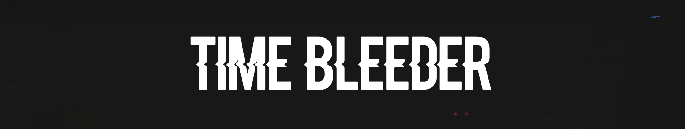
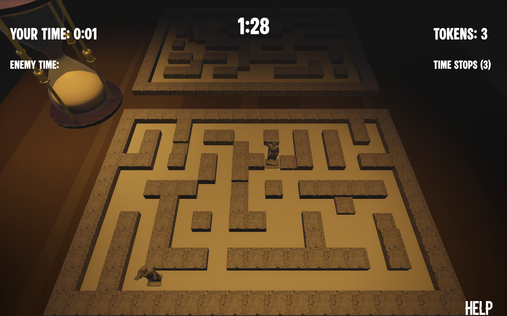
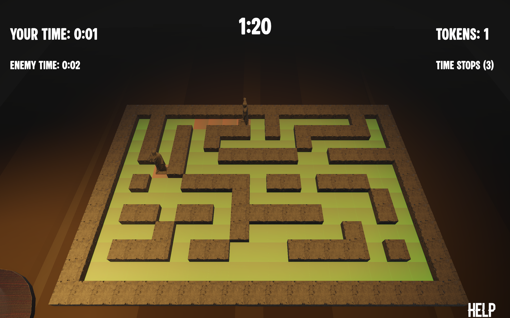
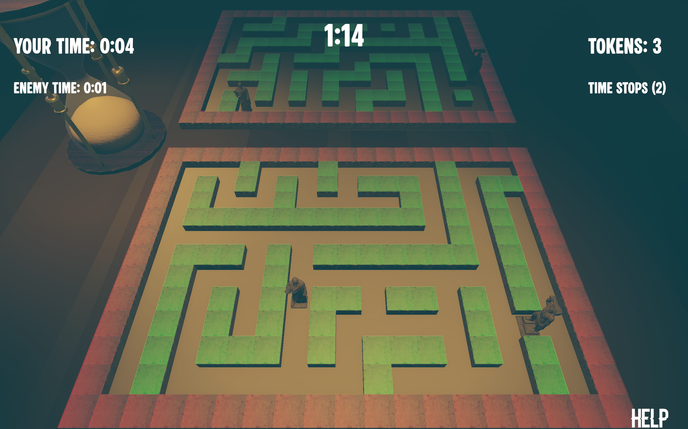

<div align="center">




**A 1v1 online strategy game where the winner is whoever wastes more of their opponent's time.**

Built in Unity in 24 hours for the University of Bristol CSS Game Jam (theme: *Time*).

[](https://typevoidgames.itch.io/time-bleeder)


</div>

---

## Table of Contents

- [About the Game](#about-the-game)
- [How to Play](#how-to-play)
- [Controls](#controls)
- [Technical Overview](#technical-overview)
- [Technical Challenges and Solutions](#technical-challenges-and-solutions)
- [What I Learned](#what-i-learned)
- [Team](#team)
- [Running the Project](#running-the-project)
- [Credits and Acknowledgements](#credits-and-acknowledgements)
- [Licence](#licence)

---

## About the Game

Time Bleeder is a fast-paced, top-down 3D strategy board game for two players over a network. Each player owns a board containing a randomly generated maze, a piece to protect, and a relentless hunter that chases that piece. The goal is not to survive, but to **stall**: every second the hunter spends searching for you is a second you bank, and the player who banks more time when the shared clock runs out wins.

Players manipulate the maze in real time by raising walls, lowering walls and moving their own piece, trying to send the hunter on the longest possible route. With only a handful of actions per turn, deciding when to defend, when to sabotage the opponent and when to cash in your banked time becomes a tense game of resource management.



The game was made for the CSS Game Jam, hosted by the Computer Science Society at the University of Bristol on 7th and 8th November 2026. The jam lasted 24 hours and the theme was *Time*.

## How to Play

**Setup.** Two players join a lobby (one hosts, one joins). Both share a single clock that starts at **1:30**, and each player gets their own board with a randomly generated maze.

**Your turn.** The hunter chases your piece through your maze. While it does, every second it spends trying to reach you is added to your **gained time**. Each turn you receive **3 tokens**, which you can spend to:

- **Raise a wall** to block a path
- **Lower a wall** to open a path (useful for reshaping the maze in your favour)
- **Move your piece** to a reachable tile

Tokens reset at the start of every turn. Your turn ends when you press the **sand timer** to bank your time, or when the hunter catches you.

**Getting caught.** If the hunter catches you, you lose **5 seconds** of gained time (it never drops below zero), your board is regenerated and the turn passes to your opponent.

**Sabotage.** During your opponent's turn you have **1 token** to interfere with their board. You can also spend some of your own tokens on their board during your turn if you are happy with your position.

**Time stops.** Each player has **3 time stops for the whole game**. A time stop freezes all clocks and the hunter for 5 seconds, or until the turn is switched with the sand timer. Everything else stays active, so you can use the pause to rearrange your board without the hunter moving.

**Winning.** When the shared clock reaches zero, the player with the most gained time wins. That means either you got more turns of stalling, or you got caught fewer times and kept more of what you earned.

**Keeping it fair.** If a player gets a lucky spawn and keeps stalling for a long time, the game randomly lowers a selection of walls on their board. This catch-up mechanic makes a strong position harder to defend indefinitely. Only the player who is caught has their board reset.

**Don't worry about learning it all at once.** The game includes an interactive, single-player tutorial that lets you experiment without time pressure.



## Controls

| Input | Action |
| --- | --- |
| **1** | Wall raise mode (highlights tiles that can be raised) |
| **2** | Wall lower mode (highlights walls that can be lowered) |
| **3** | Player move mode (highlights tiles you can move to) |
| **Left click** on a tile | Perform the action for the current mode |
| **Left click** on the sand timer | End your turn early |
| **W / S** | Switch the camera between your board and your opponent's |
| **E** | Use a time stop |

Actions only work in their matching mode, and the highlights show which tiles are valid before you click.



## Technical Overview

| | |
| --- | --- |
| **Engine** | Unity 6.6.8 (3D, top-down camera) |
| **Networking** | Netcode for GameObjects, host-client, server-authoritative |
| **Lobby** | Unity Multiplayer Session building block |
| **Maze generation** | Recursive backtracking |
| **Hunter pathfinding** | Dijkstra's algorithm |
| **Wall validation** | Custom variant of Tarjan's articulation point algorithm |
| **Platform** | Windows |

### Architecture

The project began with a short game development document that fixed the architecture, which algorithm would be used for each job and how the pieces would connect, before any code was written. In its final form the flow is:


- **Server.** Owns the authoritative game state: player positions, hunter positions, token counts, both players' gained time, the shared clock and the state of both boards.
- **Clients.** Render whatever the server tells them. They update the 3D visuals, highlight valid tiles for each mode and drive the UI. Player movement is handled locally, but the starting position is decided by the server.
- **Board state sync.** Maze state is sent as a `NetworkList` of a custom `BlockData` struct, holding each tile's `Vector2Int` position and two flags: whether it can be raised, and whether it is a floor or a wall.

### Algorithms

- **Recursive backtracking** generates a fresh random maze at the start of the game and whenever a board is reset.
- **Dijkstra's algorithm** drives the hunter, finding the shortest route to the player's piece through the current maze.
- **Tarjan's articulation points** (adapted for this game) decides which walls a player may legally raise. The rule is that a path from the hunter to the player must always exist, so nobody can wall themselves in. A wall is only raisable if doing so does not disconnect the two.

## Technical Challenges and Solutions

### 1. Server-authoritative multiplayer

**Challenge.** Time Bleeder needed both players to see consistent state, and it needed the server to be the single source of truth, so neither client could desync or cheat. Getting this working took the largest share of the jam. A major obstacle was that Netcode for GameObjects RPCs can only transmit primitive types, while the game's maze, built by the algorithms, was represented with custom classes and 2D arrays that could not be sent directly.

**Solution.** The networking layer uses a small set of purpose-built data types and conversion code:

- A `BlockData` struct holds each tile's position, a raisable flag and a floor-or-wall flag, making it simple to send over the network.
- Converters translate between the algorithms' own board representation (an array of bools) and `BlockData`, in both directions.
- The server applies every change and publishes the result through a `NetworkList<BlockData>`, and clients only react to what they receive.

Once this workflow was established, extending the networked game with new features and scaling the network logic became fast.

To avoid building a lobby system from scratch in 24 hours, the project uses Unity's Multiplayer Session building block. This gave a ready-made lobby and connection flow and freed up time for the gameplay and networking.

### 2. Integrating the algorithms with the networked game

**Challenge.** The maze generation, pathfinding and wall validation were developed as a single-player system, with the generator feeding straight into a board controller. Moving this to a server-authoritative design meant a complex migration, made harder because the person writing the algorithms was not yet familiar with how Netcode for GameObjects works, and the algorithm code had not been designed with a client-server split in mind.

**Solution.** The code was split apart and a new layer inserted between the generator and the board:

```
Before:  Maze generation -> Board controller
After:   Maze generation -> Game and network controller -> Board controller
```

The central game and network controller became the proxy that holds the authoritative state and talks to the algorithms, while the board controllers on each client became display-only. The converters from the first challenge make the two sides compatible. The migration was awkward, but it resulted in a clean separation between logic and visuals.

## What I Learned

**Multiplayer in Unity.** This was my first project using Netcode for GameObjects, and it was the biggest new skill I gained. I learned how to design a server-authoritative game, decide what the server owns versus what clients should only display, and handle a distributed system where several machines must agree on one version of the truth. I also learned how restrictive RPCs are in practice, and how to design data types and converters that make complex game state easy to sync.

**Planning pays off.** Writing a game development document before starting was one of the best decisions we made. Having the architecture, the algorithms and how everything connected agreed in advance meant we could work in parallel for 24 hours with very little confusion about who was building what.

**What I would change.** The document was not explicit enough about where my teammate's algorithms would plug into the networking code. Because of that, we had to break the code apart late in the project and slide a proxy layer between the generator and the board. Next time I would define these integration points, and how the algorithm code would interact with the network layer, during planning so that the structure is right from the start.

**Feedback and the tutorial.** We did not win any awards. Our game was largely hand-made, which made it feel modest next to some entries that leaned heavily on AI generation. The most useful feedback was that the game was hard to pick up. This was partly intentional, since we wanted real strategic depth, but with roughly four minutes to present at a jam it made the game hard to judge. After the jam I built an interactive single-player tutorial to address this. I cloned the multiplayer scenes and components, removed the networking so one player could manipulate their own board, and added a tutorial manager wired into the new single-player architecture. It lets new players learn the mechanics and experiment without time pressure, and it is included in the published build.

**Working together.** My teammate and I have worked together on GitHub for a long time, so the version control and collaboration workflow was already smooth. This project reinforced how much easier a 24-hour sprint is when you trust each other's areas and split work cleanly.

## Team

Time Bleeder was built by a team of two, under the name **TypeVoidGames**.

| Member | Contributions |
| --- | --- |
| **[Mateusz Golebiewski](https://github.com/MateuszGolebiewski591)** | Networking (Netcode for GameObjects), central game logic, audio, wiring the components together, post-jam single-player tutorial |
| **[Rowan Watcham](https://github.com/RowanWatcham)** | Algorithms (maze generation, hunter pathfinding, wall validation, maze permutation), 3D scenes and visuals |

## Running the Project

**Play the game:** download the Windows build from [itch.io](https://typevoidgames.itch.io/time-bleeder).

**Open the project:**

1. Install Unity 6.6.8 through Unity Hub.
2. Clone this repository.
3. Add the project in Unity Hub and open it.

Multiplayer uses the Unity Multiplayer Session building block, so you will need an internet connection and a Unity project linked to Unity Gaming Services to test online play from the editor.

## Credits and Acknowledgements

The game was created in under 24 hours thanks to the following assets and resources. An acknowledgements tab on the main menu also credits them in-game.

**Unity Asset Store**

- Dark Theme UI by Giniel Villacote
- Free Casual Game SFX Pack by Dustyroom
- Free Energy Hard Rock Music Pack by Andrew Sitkov Music
- Free Sound Effects Pack Starter - All categories by Olivier Girardot
- KE Statues - Lite by KE 3D Assets
- Sand Clock by 3d.rina
- Slavic Medieval Village Free - Modular Environment Kit by EmacEArt
- STYLIZED Deep Sea Hunter's Station - Low Poly 3D Art

**Unity Technologies**

- Multiplayer Session | Unity Building Block

**Pixabay sound assets**

- TIME FREEZE TENSION by SOUNDS_YKT
- Opening Bell by u_7xr5ffk4oq
- Clear Bell Chime by Universefield

**Code**

- Maze generation is based on the open-source [MazeGenerator.cs](https://github.com/Gary-The-Cat/MazeSolver/blob/master/MazeSolver/MazeGenerator.cs) from Gary-The-Cat/MazeSolver.
- The Dijkstra's algorithm implementation is adapted from an open-source implementation found online.
- The Tarjan articulation point variant was adapted for this game with AI assistance (Claude).

## Licence

This project has no formal licence. The source is left open for others to look at and learn from.
